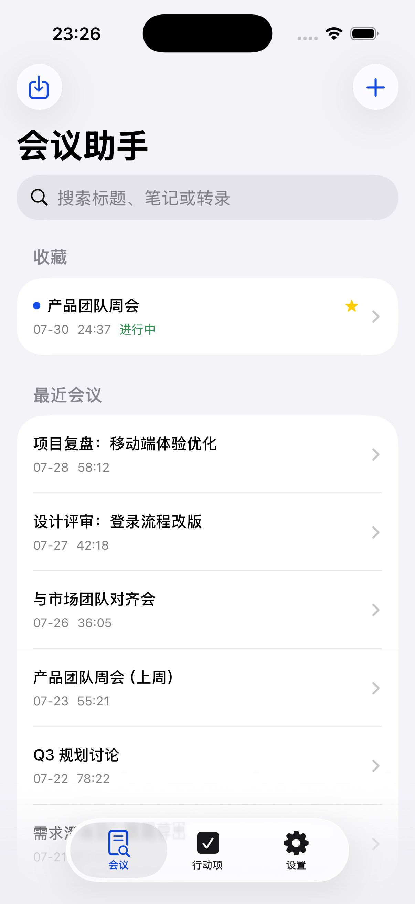
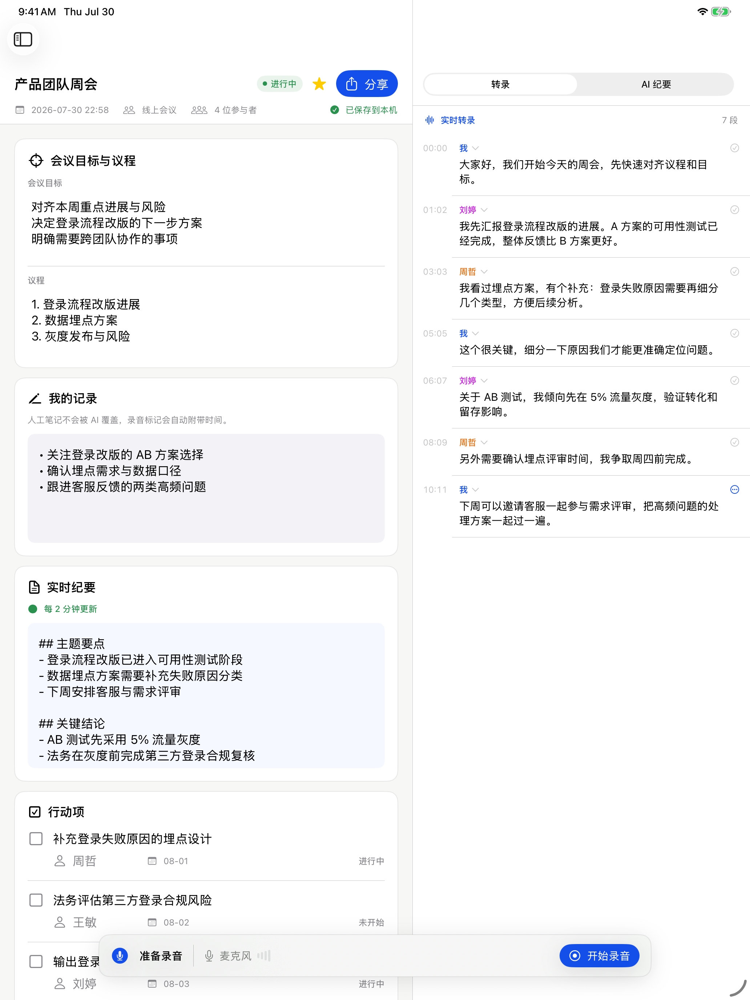

# MinuteFlow iOS

SwiftUI 编写的 iPhone 与 iPad 通用版本，目标系统为 iOS/iPadOS 18 及以上。

## 主要能力

- SwiftData 本地会议库、全文范围搜索、收藏、软删除与恢复
- 可编辑会议目标、议程、人工笔记、实时纪要、决策、问题、风险与行动项
- 麦克风录音、暂停/继续、音量反馈、时间戳标记和 Apple Speech 实时转录
- 默认两分钟增量纪要，停止录音后执行最终整理
- 会议回放：文档页紧凑「回放」入口展开时间轴，倍速循环（会话内记忆）；
  转录时间戳点按跳转，当前播放片段歌词式高亮并自动跟随
- AI 问答：基于当前会议纪要与转录提问（复用在线纪要模型，只发文本不发音频），
  回答流式接收并以打字机平滑铺出（40→160 字/秒自适应、标点小停顿）
- OpenAI 兼容纪要模型和远程 Whisper 导入配置，API Key 保存到 Keychain
- 设置工作台：「AI 总结」与「语音转录」两个独立任务，各自在本机运行与
  在线服务之间选择，内置 DeepSeek/Kimi/通义千问/智谱/OpenAI/New API 网关
  等常用预设与真实请求连接测试
- 音频/视频文件导入与 Apple Speech 或远程 Whisper 转录
- Markdown、TXT、SRT 与 JSON 备份导出
- iPad 多栏工作区与 iPhone 标签页/导航栈自适应布局

## 与桌面端的功能对齐

iOS 端优先对齐桌面端的高频能力（回放、AI 问答、设置信息架构）。以下能力
仍属桌面端独有，列入后续版本评估：

- 本地 Whisper（whisper.cpp GGML/GGUF 运行时与模型下载目录）——iOS 当前为
  Apple Speech + 远程 Whisper 双路径
- 本地声纹说话人识别（跨会议声纹册）——iOS 刻意只做手动改名，不识别身份
- 系统音频双轨录音——平台限制，iOS 仅录制麦克风
- 付费授权体系（激活码/反激活/找回）——iOS 版当前免费，未接入内购

## 工程

工程由 XcodeGen 生成，已提交可直接打开的 `MeetingAssistant.xcodeproj`。

```bash
xcodegen generate
xcodebuild test \
  -project MeetingAssistant.xcodeproj \
  -scheme MeetingAssistant \
  -destination 'platform=iOS Simulator,name=iPhone 17 Pro'
```

## 平台限制

- iOS 版本录制麦克风输入，不捕获其他 App 的受保护系统音频。
- Apple Speech 是否完全在设备端运行取决于语言、设备和系统资源。
- 当前说话人标签支持手动改名与重新分配，不建立跨会议声纹或推断真实身份。
- 提交 App Store 前仍需发布方配置开发团队、真机权限测试和 TestFlight 验证。

## 验证截图

| iPhone | iPad |
| --- | --- |
|  |  |
